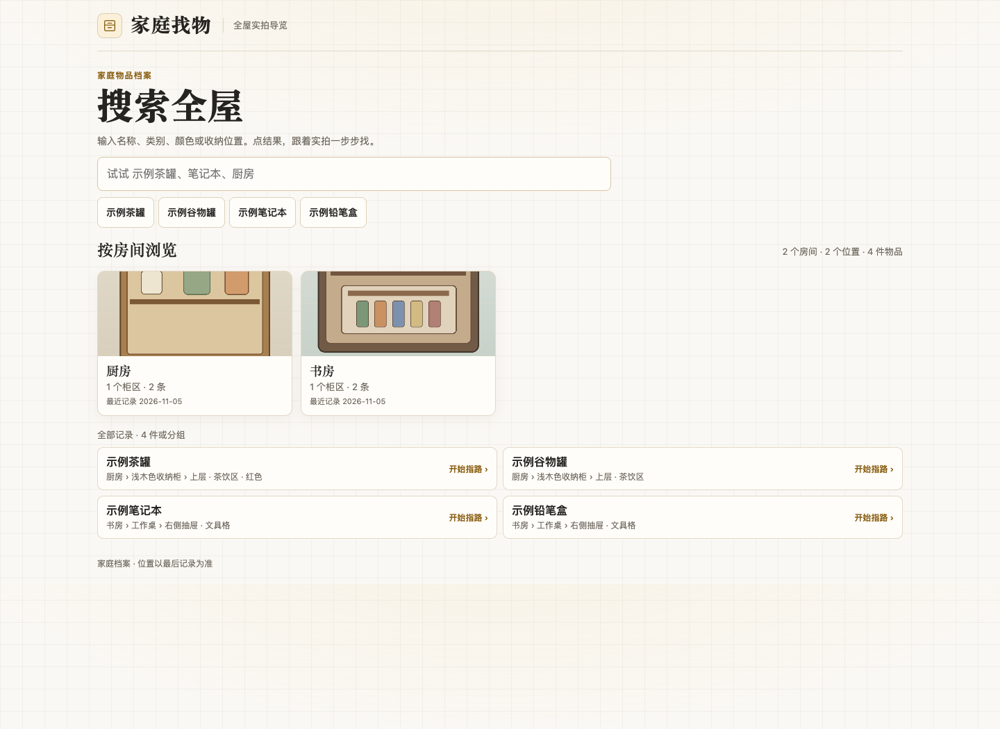
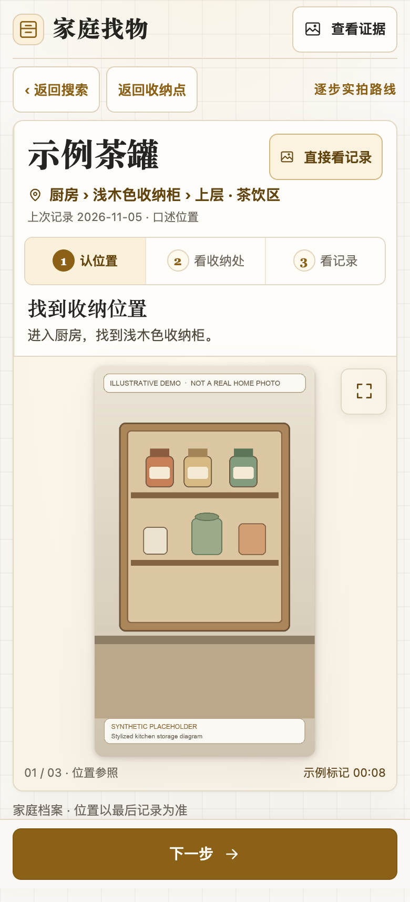

# Home Finder · 家庭找物

Home Finder 是一个本地 Codex Skill。给它一段手机走拍、几张照片，或者一句明确的位置说明，它可以把有依据的物品和收纳位置整理成一份家庭档案，并生成**能搜索、能一步步看实拍的 HTML 导览**。

例如搜「调料」「蓝色」「C2A」或「书房」，首页也保留「按房间浏览」入口。点房间后，再选柜体、层或抽屉，最后进入物品的实拍路线。只记得用途时，也可以直接在聊天里问「做蛋糕时打发蛋白的那个小机器在哪？」确认物品后，Skill 会给出同一张网页里的实拍路线。

## 界面预览

下图是实际运行的网页截图，使用匿名演示档案与示意素材。用自己的视频或照片录入后，路线会显示你提供的实拍证据。

**搜索首页。** 输入物品名、别名、颜色或收纳位置，也可以按房间浏览。



**逐步指路。** 点结果后，按实拍认柜体、打开柜门或抽屉、确认物品；照片可以放大。



## 安装与首次使用

需要能读取本机文件的 Codex 环境、Python 3.10 或更高版本，以及一个现代浏览器。视频的抽帧和可选旁白转写由当前环境可用的本机媒体工具完成，Python 脚本负责档案校验、增量写入与网页导出。

下载这个仓库，将 [`skills/home-finder`](skills/home-finder/) 文件夹放进你的 Codex skills 目录。例如在 macOS 的终端中首次安装：

```bash
git clone https://github.com/HenLuu/home-finder.git
mkdir -p "$HOME/.codex/skills"
cp -R home-finder/skills/home-finder "$HOME/.codex/skills/"
```

随后在能访问你的素材和档案的 Codex 聊天中说 **`$home-finder 第一次使用`**。如果聊天还没看到刚安装的 Skill，可以从新聊天调用它。首次使用时房间尚未明确就会问「你想先录哪个房间？厨房、卧室，还是其他房间？」已说清房间时直接继续。首次建档由对话引导，并在你选择的私人文件夹准备档案。

## 从录视频到打开 HTML

| 阶段 | 用户可以怎么说或怎么拍 | Skill 会做什么 |
| --- | --- | --- |
| 选范围 | 首次使用时，房间尚未明确就会问「你想先录哪个房间？厨房、卧室，还是其他房间？」你也可以主动指定先录某个局部。 | 默认按整个房间给拍摄指引。用户主动指定局部时，按真实位置记录在该房间下。已有可用档案时继续使用，首次实际建档时才需要确认私人保存位置。 |
| 拍摄 | 从入口拍能辨认的地标。到柜子前先拍外观，再连续拍打开柜门或抽屉。对内部分层稳住两三秒。可边拍边说「上层是清洁用品」。 | 利用画面及可用旁白确认物品、位置层级与来源时间。能认出一包线就先记录线包，单根接口看不清时保留待核。 |
| 交素材 | 把视频放到运行 Codex 的电脑能读取的文件夹，把完整路径粘到聊天里。macOS 的 Finder 选中文件后按 `⌥⌘C` 可复制路径。照片也可通过聊天的可读附件提交。 | 验证素材可读。只有柜体、层位或物品身份还分不清时，才追问一件能缩小范围的信息。 |
| 建档并试查 | 「请录入这段厨房视频。」录好后可以换个叫法搜同一件物品。 | 同一档案记录本次确认的条目、位置、实拍图与证据范围。导出带房间入口的主导览页，给你实际可打开的入口。 |

补录照片时，最容易核对的是一张能认柜体与层位的环境照，再加一张物品近照。只有近照时，也可以补一句物品放在哪里；位置仍不明确的候选待补齐后再进入指路。

## 网页和聊天各适合什么时候用

| 你想做什么 | 示例 | 会得到什么 |
| --- | --- | --- |
| 自己快速搜 | 网页搜「沙茶酱」「调料」「绿色」或「书房」。 | 结果显示物品和收纳位置。点「开始指路」，按当前证据查看柜体、层位和物品。 |
| 浏览某个收纳点 | 点房间，再点柜体、层或抽屉，最后点物品。 | 看到该位置已记录的内容，也能进入单件物品的路线。 |
| 直接让我代查 | 「帮我找 C2A 线包，给我实拍路线。」 | 查当前档案，给一句位置和可点开的物品链接。 |
| 只记得用途或外观 | 「做蛋糕时打发蛋白的小机器」或「那个绿色包装的东西」。 | 聊天结合名称、用途、位置和已有照片确认身份。有多个候选时会请你补一个有区分力的特征。 |
| 以后想用新叫法搜 | 「对，就是这件。以后也可以叫它‘打蛋液的机器’。」 | 确认后可给同一个物品补别名。重新导出后，网页也可以用新叫法找。 |

HTML 是一份可离线打开的快照。搜索、页面代码和使用的照片都内嵌在文件里。**只想在另一台电脑查看时，复制这一个 HTML 即可。** 需要在另一台电脑继续维护时，再带上家庭物品档案和它的照片附件。家里如果有一个私有局域网网页入口，手机也能在浏览器里打开；独立 HTML 仍可在电脑上直接使用。

## 继续录房间、补证据和搬动物品

- **加房间**。可以说「继续录书房，沿用同一个家庭档案。这是新视频路径。」一个房间可以整段拍，也可以逐个柜体补。Skill 会把确认的新内容追加到同一档案，沿用现有主导览文件名，并在已有房间卡片后按位置首次入档顺序追加新卡片。主导览覆盖全屋，不按房间筛选。只有明确要求房间专页时才单独筛选。
- **搬了一件**。可以说「我把 C2A 线包从书桌柜第 5 层移到卧室小桌了。」物品身份和新位置都明确时，一句话即可登记。新位置注明是口述，旧位置和旧物品照留在档案历史。
- **补新位置的实拍**。可以说「线包就在卧室小桌。这是小桌外观和线包近照，帮我补到路线。」核对证据后更新当前路线，原物品的身份和别名继续沿用。
- **柜子或布局变了**。可以说「书桌边柜移到窗边了。这段视频从房门拍到新位置，请更新这一带的指路。」Skill 会按能确认的地标、柜体和层位逐项更新。

写入并校验档案后，Skill 重新导出受影响的 HTML。打开原链接并刷新，搜索与指路会读到更新后的快照。位置仍需要核对时，可以先补一个清楚的地标、开柜镜头或物品近照。

## 东西没有归位时怎么找

可以直接说 **「原来的抽屉我查过了，没找到。帮我回想一下可能放在哪。」** 这会进入聊天里的失物回溯。即使物品还没入档，也可以从你最近一次确定见到它时的动作开始。

1. Skill 先问最后一次确定见到或拿着它时，你在哪儿、在做什么。
2. 根据你说的动作、换包或腾手的节点，给出最多三处值得查的位置。每一处会说明为什么先查以及具体翻哪里。
3. 你回报「袋子倒空检查过」「桌上只扫了一眼」，Skill 会缩小待查范围。已完整检查的位置会退出这轮建议。
4. 找到以后，你可以说「这次忘了放回」结束搜索。要改变长期收纳位置时，可以接着说「以后固定放玄关上层抽屉」。

例如你说「我在书桌签字，后来拿着纸去玄关拆快递，又把纸塞进帆布袋」，Skill 可以建议先翻袋里的纸张之间，再查签字时的桌沿和玄关腾手的台面。这些是按当前线索排序的**待查点**，现场结果由你确认。

## 当前范围

- 已有可搜索的区域与全屋 HTML、实拍路线和来源时间、增量录入、口述移位历史及聊天里的失物回溯。
- 新家庭采用聊天引导建档。自动初始化向导、整段视频的一键理解和统一待补照片列表仍是后续方向。
- 导览以最后确认的记录为准。颜色、用途和别名来自已录证据或用户确认，具体层位或物品身份不足以判断时保留待核。

实现入口在 [Skill 说明](skills/home-finder/SKILL.md)。资料保存在用户选择的私人目录，公开仓库里的界面截图使用演示数据。
